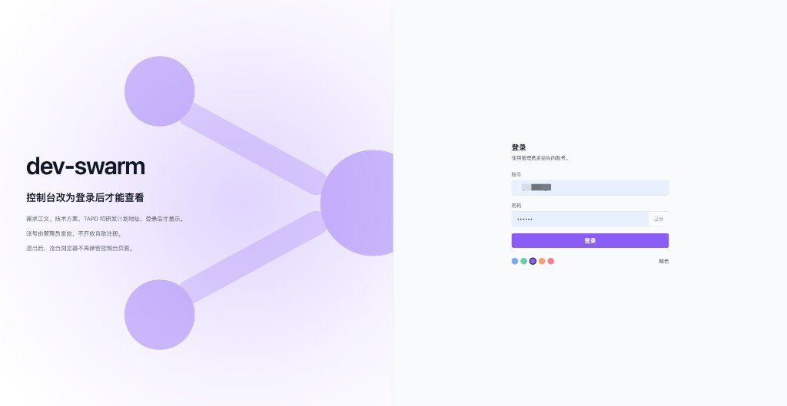
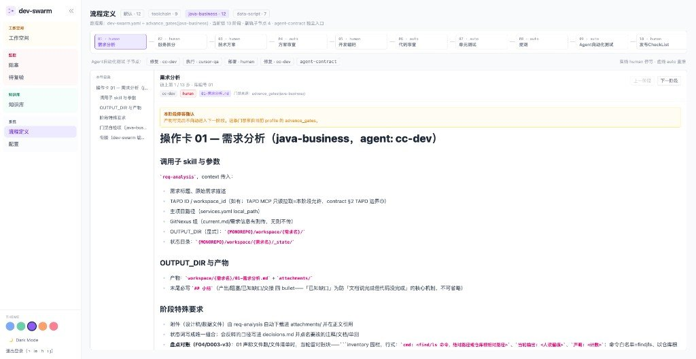

# 快速启动

从空机器到看板上能看见一个需求，按下面的顺序做。引擎在本仓库，阶段技能在 [dev-skills-kit](https://github.com/jerrey17/dev-skills-kit)。

## 准备

- Git
- Node.js 和 npm
- Python 3，以及 PyYAML（`python3 -c "import yaml"` 失败时执行 `python3 -m pip install pyyaml`）

准备两个目录，不要叠在一起：

| 目录 | 用途 |
|---|---|
| 工作区 | agent 在这里改 `workspace/{需求名}/` |
| 数据克隆 | 看板后端只读它，并定时 `git pull --ff-only` |

数据克隆不要指向正在改文件的工作区。后端发现路径里没有 `dev-swarm.yaml` 会直接退出。

```bash
git clone https://github.com/jerrey17/dev-swarm.git ~/dev-swarm
git clone https://github.com/jerrey17/dev-swarm.git ~/dev-swarm-data
cd ~/dev-swarm
bash hooks/setup.sh
```

`hooks/setup.sh` 把本仓库的 `core.hooksPath` 指到 `hooks/`。工具路径的 push 需要提交说明里有 `Approved-by: human`。

打开 `dev-swarm.yaml`，确认：

```yaml
workspace:
  remote: https://github.com/jerrey17/dev-swarm.git
  branch: main
  local: .
knowledge:
  - { project: default, type: local-path, ref: "" }
```

`local` 保持 `.`，表示当前工作区。有本地知识库时，把 `knowledge` 的 `ref` 改成该目录的绝对路径；没有就留空。

## 安装阶段技能

```bash
git clone https://github.com/jerrey17/dev-skills-kit.git ~/dev-skills-kit
mkdir -p ~/.claude/skills
for d in ~/dev-skills-kit/*/; do
  [ -f "$d/SKILL.md" ] && cp -R "$d" ~/.claude/skills/
done
mkdir -p ~/.claude/skills/dev-swarm
cp ~/dev-swarm/skill/adapters/cc/SKILL.md ~/.claude/skills/dev-swarm/SKILL.md
```

Cursor 用 `~/.cursor/skills/`，同样复制一遍。

然后编辑 `~/.claude/skills/dev-swarm/SKILL.md` 里的 `MONOREPO=`，写成工作区绝对路径，例如 `/home/you/dev-swarm`。

这些技能正文里还有旧的 `workflow/` 路径。在 dev-swarm 里，产物目录是 `workspace/{需求名}/`，文件编号以 `skill/pipeline/ops/` 为准。

## 配置看板后端

后端是 `console/server` 里的 Express，只监听 `127.0.0.1:4600`。页面是 Vite，`127.0.0.1:5173`，把 `/api` 转到 4600。

在工作区里：

```bash
cd ~/dev-swarm/console
npm install
npm --prefix client install
mkdir -p .local-state
cp .local-state/console.config.example.yaml .local-state/console.config.yaml
```

把 `console.config.yaml` 改成数据克隆的绝对路径。通知地址可以留空，留空则不发消息。

```yaml
dataClone: /home/you/dev-swarm-data
pollIntervalSeconds: 30
webhookUrl: ""
port: 4600
```

`.local-state/console.config.yaml` 和账号文件都在 gitignore 里，不要提交。

发放登录账号。没有账号时，接口一律 401。密码至少 6 位，磁盘上只存盐和散列。

```bash
cd ~/dev-swarm
node console/server/accounts.mjs add <账号>
node console/server/accounts.mjs list
```

改密码：删掉 `console/.local-state/accounts.local.yaml` 里该账号那一段，再执行一次 `add`。服务不用重启。

## 启动

```bash
cd ~/dev-swarm/console
npm run dev
```

看到后端打印 `dev-swarm-console http://127.0.0.1:4600`，浏览器打开 http://127.0.0.1:5173 ，用刚发放的账号登录。



也可以用仓库里的脚本（它会在缺依赖时安装 `console/` 的包；`client/` 仍要先单独安装）：

```bash
ln -sf ~/dev-swarm/bin/dev-swarm /usr/local/bin/dev-swarm
dev-swarm start
dev-swarm status
dev-swarm stop
```

日志在 `console/.local-state/dev-swarm.log`。

后端每 30 秒对数据克隆执行 `git pull --ff-only`。工作区里的提交要先推到 `origin/main`，数据克隆拉下来之后，看板才会变。

启动失败时先看这两句：

- `dataClone 路径无效或不为 monorepo`：路径不存在，或该目录没有 `dev-swarm.yaml`。
- 页面能开、接口 401：还没有账号，或登录已过期。会话在进程内存里，重启后端后要重新登录。

## 看板页面

登录后左侧是四组导航。Logo 旁的箭头可以收起侧栏。底部五个色点切换配色，下面一行切换亮色和暗色，再下面是退出登录。退出后当前会话立即失效。

看板只读数据克隆。页面大约每 30 秒拉一次列表、阻塞和待复验；工作区刚提交的内容，要等数据克隆 `git pull` 成功后才会出现。

### 工作空间

地址是 `/`。每个需求一行，上面是进行中，下面是已终态。一行上能看到名称、绑定的 profile、当前阶段、下一手（`agent · 动作`）、已完成阶段数和更新时间。`_state/current.md` 解析失败的行是红色，点进去能看到错误原文。

点行进入 `/requirements/{需求名}`。行上的「TAPD」在新窗口打开故事链接，没有链接时不显示。「研发入口」从右侧滑出，只读 `workspace/{需求名}/_state/links.yaml`：需求级有 TAPD、研发计划、测试环境和集群、Wiki；服务级按 `services.yaml` 列出流水线和 Wiki。没填的槽显示「待办」。

详情页顶部是这条需求自己的阶段链，来自 `current.md` 里冻结的 phases。实线表示已完成或当前节点，虚线表示还没到，主色点是当前节点。点某个阶段，左侧列出该阶段产物，右侧预览。Markdown 渲染，代码、表格和图片按类型打开；不支持的类型只显示路径和大小。当前阶段还没落盘时，右侧写下一手是谁；还没走到的阶段则说明目录里没有产物。

副轨按有没有数据出现：本阶段产物、决策、历史、会话、未归类。决策来自 `_state/decisions.md`，历史来自 `_state/history/`，会话是和这个需求关联的 agent 记录。

### 阻塞

地址是 `/blockages`。卡片来自两处：`current.md` 里的 blockers，以及 `bug/INDEX.md` 和各 bug 的 `status.md` 对不上（缺行、状态不一致、INDEX 多行）。没有这些问题时页面写「无阻塞」。

### 待复验

地址是 `/reverify`。表来自各需求的 `reverify.md`。默认只显示状态为「待复验」的行，可以用名称过滤，状态下拉还有「已复验」「已打回」「全部」。列是工作空间、单号、代码根、commit、数据根、复验动作、期望、实际、实例、状态。实例为空的行标成「等部署」。新拉到的行会标「新」，大约 30 秒后标记消失。

### 知识库

地址是 `/knowledge`。只浏览 `dev-swarm.yaml` 里 `type: local-path` 且目录存在的条目。`ref` 留空时，这一页写「无可浏览的知识库」。左侧逐层展开目录，右侧用 Preview 看渲染、用 Source 看原文，可以全屏。名为 `gitnexus_repos` 的目录置灰，不能点进去。

### 流程定义

地址是 `/pipeline`。这一页读的是仓库里的阶段定义和操作卡，不读某个需求的进度。



图里从上到下是四块：

1. 顶上四个按钮切换链。`默认` 用 `dev-swarm.yaml` 的 `pipeline.profile`。另外三条是 `toolchain`（9 阶段）、`java-business`（12 阶段）、`data-script`（7 阶段）。旁边一行写数据源、当前链有几阶段、副轨有几个子节点。
2. 阶段轨。点一块，下面整页换成该阶段的操作卡。边框实线是 `human`：产物写完后停住，等人确认才进下一阶段。虚线是 `auto`：门禁通过后直接推进。块上的编号是库里的阶段号，和链上的先后不是同一件事（java-business 会跳过 13）。
3. 副轨。`Agent自动化测试` 的子节点（执行、部署、修复等）点进去会打开 09 的操作卡，并滚到对应小节。`agent-contract` 是协作协议，不进阶段链。右侧图例：实线 human 停等，虚线 auto 直推。
4. 阅读区。左栏是操作卡的小节目录。右栏标题下是执行 agent、门禁（`human` 或 `auto`）、操作卡文件名、门禁来自当前 profile 的 `advance_gates` 还是仓级兜底。`human` 阶段顶部有黄色提示。`上一阶段` / `下一阶段` 沿当前这条链走。

操作卡正文在 `skill/pipeline/ops/`。改完推送，数据克隆拉到之后，刷新这一页就能看到。

### 配置

地址是 `/config`。只读，敏感值已掩码。左侧分类：

| 分类 | 里面是什么 |
|---|---|
| 三级配置 | `skill/config/defaults.yaml`、仓级 `dev-swarm.yaml`、合并后的有效值、各需求的 L3 覆盖 |
| 流程 profile | `toolchain.yaml`、`java-business.yaml`、`data-script.yaml` |
| 规范 SPEC | 变更流程、目录规范、提交规约、脱敏红线 |
| hooks | `pre-push` 和 `setup.sh` |
| console 运行配置 | 示例文件，以及当前进程实际读到的数据目录、端口、轮询间隔（通知地址若有会打码） |
| 流程文档 | 跳回流程定义页 |

页头还会写当前数据克隆的 tag 和 commit，以及哪些需求有 L3 覆盖。这里改不了文件，改配置仍在工作区里编辑后提交。

## 放进一个需求

```bash
cd ~/dev-swarm
mkdir -p workspace/示例需求/{attachments,_state/history,bug}
cp skill/templates/services.yaml workspace/示例需求/services.yaml
cp skill/templates/current.md workspace/示例需求/_state/current.md
cp skill/templates/decisions.md workspace/示例需求/_state/decisions.md
cp skill/templates/bug-INDEX.md workspace/示例需求/bug/INDEX.md
cp skill/templates/reverify.md workspace/示例需求/reverify.md
```

按 `skill/templates/README.md` 填空。`current.md` 的 `name` 必须等于目录名。提交并推送后，等数据克隆拉到这次提交，看板列表里会出现「示例需求」。

检查工作区：

```bash
python3 skill/scripts/check_workspace.py workspace 示例需求
bash skill/tests/run_all.sh
```

## 和阶段技能的对应

| 阶段 | 技能目录 |
|---|---|
| 01 需求分析 | req-analysis |
| 02 服务拆分 | service-split |
| 03 技术方案 | tech-solution-design |
| 03 推 Wiki | tapd-wiki-publish |
| 05 开发编码 | java-coding-workflow |
| 05 / 06 对齐 | doc-design-code-gap-review |
| 06 规范审查 | java-code-review |
| 07 单元测试 | new-test-development |
| 08 提测 | submit-for-testing |
| 09 四步法 | flow-verify-four-step |
| 09 修复 | bug-fix |
| 10 发布清单 | release-checklist |
| 11 之后沉淀经验 | workflow-learnings-to-kb |
| 12 知识库更新 | knowledge-base-update |

04 方案审查、13 编写脚本、14 发布验证的规则在 `skill/pipeline/ops/`，没有单独的技能目录。
